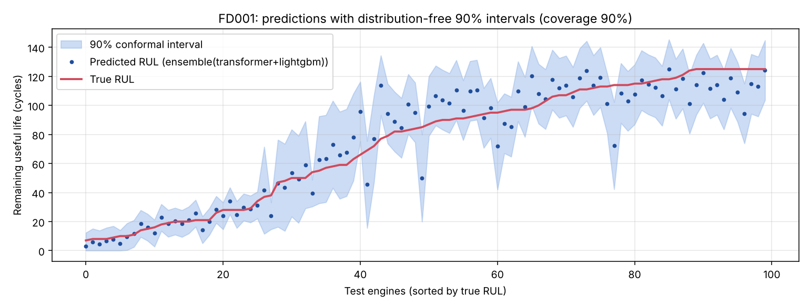

# Fleet Readiness: Predictive Maintenance for Aircraft Engines with Guaranteed Uncertainty

> **Mission:** Keep a fleet mission-ready by predicting how many cycles each engine has left, attaching a
> *statistically guaranteed* safety margin to that prediction, and turning it into a capacity-constrained
> maintenance schedule that minimizes cost **and** in-service failures.
> Data: **NASA C-MAPSS** turbofan run-to-failure benchmark (real, public domain).



## Headline results (test set; multi-seed; reproducible with one command)

| | FD001 (1 fault mode) | FD003 (2 fault modes) |
|---|---|---|
| Selected model (chosen on **validation**, never test) | Transformer + LightGBM ensemble | Temporal Transformer |
| Test RMSE / NASA score | **12.37** / 234 | **12.84** / 367 |
| 90% conformal interval coverage | **90.0%** | **91.0%** |
| Interval width near failure (RUL < 40): Mondrian vs split conformal | **19.1** vs 35.2 cycles | **19.5** vs 40.4 cycles |
| In-service failures: risk-aware MILP plan vs alert rule | **1 vs 14** | **2 vs 22** |
| Realized cost: MILP plan vs alert rule | **$13.6M vs $41.7M** | **$19.1M vs $60.1M** |

The bottom two rows are scored against **ground-truth remaining life** (known only in hindsight), not against
the model's own beliefs.

### Full model benchmark (`results/benchmark.md`)

| Model | FD001 RMSE | FD003 RMSE | Params |
|---|---|---|---|
| LightGBM on engineered window features | 12.20 | 12.63 | - |
| LSTM (3 seeds) | 13.41 ± 0.14 | 14.02 ± 0.21 | 56k |
| TCN, dilated causal convs (3 seeds) | 14.21 ± 0.69 | 16.18 ± 0.34 | 92k |
| Transformer, [CLS] + learned positions (3 seeds) | 14.65 ± 0.52 | 13.57 ± 0.60 | 106k |
| Transformer + LightGBM ensemble | 12.37 | **12.11** | - |

**An honest reading:** on a 2-core CPU budget (30 epochs), a well-featured gradient-boosting model is a very
strong baseline on FD001. Deep sequence models only pull ahead on FD003, where two interacting fault modes
reward learned temporal features, and the ensemble is the most robust choice overall. The point of the project
is the decision layer: guaranteed intervals and an optimized plan that work with *whichever* model wins.

## What makes it advanced

1. **Leakage-safe data handling.** Splits are by engine (never by row) into train / validation (early stopping) /
   calibration (conformal only) / test. The calibration set mimics deployment: trajectories truncated at random
   points, one window each.
2. **Three deep architectures + GBM + ensemble**, selected on validation, with MLflow tracking of every run.
   The training recipe uses unit-scaled targets, warm-up + cosine LR, Huber loss, and no early stop before the LR anneals
   (fixing that recipe cut the FD003 LSTM error from 17–44 to 14.0).
3. **Conformal prediction (distribution-free, finite-sample guarantee).** Plain split conformal gives one width for
   every engine. **Mondrian conformal** calibrates per predicted-RUL band, so intervals are **~2x tighter exactly where
   decisions are made (near failure)** while keeping 90% coverage.
4. **Explainability.** Integrated Gradients (implemented from scratch, with a completeness unit test) for the deep model
   and TreeSHAP for the GBM, aggregated to physical sensors. The top drivers (HPC static pressure Ps30, LPT outlet
   temperature T50, fuel-flow ratio phi) match the known degradation physics of the HPC fault mode.
5. **Decision optimization.** A mixed-integer program (HiGHS) assigns engines to hangar slots over a 30-day horizon.
   Failure probabilities come from the *empirical calibration residuals*, not an assumed Gaussian. It is scored against
   a realistic "alert when prediction < 30" rule.

## Quick start
```bash
pip install -r requirements.txt
bash scripts/download_data.sh                 # NASA C-MAPSS FD001-FD004
python scripts/run_pipeline.py                # benchmark → conformal → explain → schedule (~45 min CPU; restart-safe)
streamlit run app.py                          # fleet readiness dashboard
pytest -q                                     # 10 tests (shapes, conformal coverage, IG completeness, MILP capacity)
mlflow ui --backend-store-uri sqlite:///mlflow.db
```

## Repo map
```
src/rul/data.py        loading, RUL capping, engine-level splits, windowing, deployment-like calibration set
src/rul/models.py      LSTM, TCN, Transformer (+ MC-dropout)
src/rul/train.py       training loop (warm-up/cosine, Huber, min-epoch early stopping)
src/rul/conformal.py   split + Mondrian conformal prediction
src/rul/explain.py     Integrated Gradients
src/rul/scheduler.py   calibrated failure probabilities, MILP schedule, alert-rule baseline, realized-cost scoring
scripts/run_pipeline.py  end-to-end experiment → results/
```

## Model card
* **Intended use:** decision support for maintenance planners. A human approves every work order.
* **Not for:** airworthiness determinations or certification decisions.
* **Data:** simulated run-to-failure trajectories (C-MAPSS). Real fleets have sensor dropouts, maintenance
  resets and operating-regime shifts, so recalibrate the conformal layer on each fleet before use.
* **Guarantee scope:** conformal coverage is *marginal* (over engines), assumes calibration and deployment engines
  are exchangeable, and should be monitored for drift.
* **Cost model:** costs are illustrative parameters in `CostModel`. Plug in real program costs.
